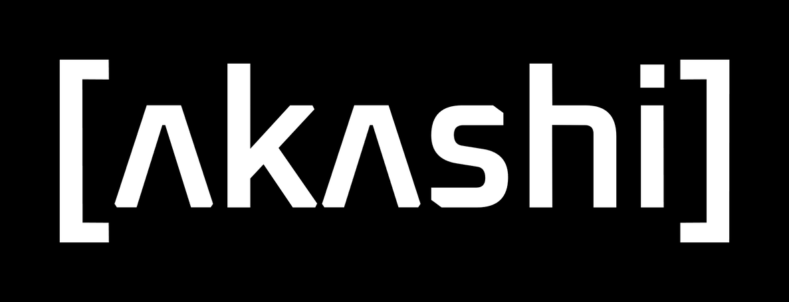

<p align="center">
  <picture>
    <source media="(prefers-color-scheme: dark)" srcset="https://raw.githubusercontent.com/0x41io/akashi/main/assets/akashi-dark.png">
    <source media="(prefers-color-scheme: light)" srcset="https://raw.githubusercontent.com/0x41io/akashi/main/assets/akashi-light.png">
    
  </picture>
</p>

**Monomi finds. Akashi proves. Kaidoku explains.**

Akashi is the third tool in the [0x41](https://0x41.sh) security suite. It takes
a lead from a [Monomi](https://github.com/0x41io/monomi) scan, confirms or rules
it out with evidence, gives the exact fix, and re-checks it after the fix:
**prove, fix, re-check.**

It is not an autonomous pentester. It never picks its own targets, never runs
exploits, and never changes anything on a target. Every active check stays
inside an approved scope and waits for a typed `yes`.

> Status: **v0.1, feature-complete.** `plan` (show what would be checked, send
> nothing), `verify` (run the checks after a typed yes), and `recheck` (re-run
> a confirmed lead after you fix it, to prove it's closed) are all built. The
> passive checks — the takeover re-check over DNS, the registry (RDAP) lookup
> that settles an unknown-service takeover, and the email re-check — plus the
> one active check (going around the CDN, inside scope) run after a typed yes,
> and a **confirmed** lead prints the exact fix to close it. The full
> **prove, fix, re-check** loop is in place.

## What it proves (v0.1)

Akashi reads the typed fields Monomi writes since v1.15.0, so it knows what each
lead is without reading its text.

| Monomi lead | How Akashi proves it | Touches the target? |
|---|---|---|
| `takeover` (claimable service) | Re-check now that the dangling CNAME still points at the deleted target and that the target still doesn't exist, on both DoH resolvers. Never claims the name. | No — DNS only |
| `takeover_unknown` | The same DNS re-check, plus a registry (RDAP) lookup: if the target's domain is registered, an attacker can't claim it (ruled out); otherwise inconclusive, since claiming a domain is a human decision | No — DNS + registry |
| `around_cdn` | One request to the fronted host through the CDN, one to the origin IP with the same `Host` header; compare the responses. A stock default page or a short generic title never counts as a match | Yes — one request each |
| `email_spoofing` | Fresh SPF / DMARC / DKIM lookup | No — DNS only |

Every verdict is **confirmed**, **ruled out**, or **inconclusive** (the default),
and carries its evidence.

## Install

Requires Python 3.14+. Akashi imports Monomi as a library, pinned to the release
whose contract test locks the fields Akashi reads.

```bash
git clone https://github.com/0x41io/akashi.git
cd akashi
python3 -m venv venv
source venv/bin/activate        # Windows: venv\Scripts\activate
pip install -e .
```

## Use

```bash
# Show what would be checked to prove a scan's leads. Sends nothing.
akashi plan scan.json --scope scope.txt

# Run the checks after a typed yes. The passive ones always run; the active
# one (around the CDN) runs only for hosts the scope allows. Records each
# verdict, with its evidence, to an append-only history per target.
akashi verify scan.json --scope scope.txt

# Some bug bounty programs want an identifying header on active traffic. Put it
# in a file (one "Name: value" per line); it's hashed, shown in the plan, and
# sent on the active requests only.
akashi verify scan.json --scope scope.txt --research research.txt

# After fixing a confirmed lead, re-run its check to prove it's closed. Only
# leads that were confirmed before are re-checked; each reports fixed, still
# open, or unclear, and the result is appended to the proof history. Leads are
# matched by what they're about (rule + targets), not their id, so a fresh scan
# taken after the fix works too.
akashi recheck scan.json --scope scope.txt
```

`scan.json` is a Monomi scan saved with `monomi --json`, from Monomi v1.15.0 or
newer. `--scope` is a scope file in Monomi's format; the active check (going
around the CDN) only runs against hosts it allows, and is shown as blocked
without it. The passive checks (DNS and registry) never contact the target, so
they need no scope.

## Known limits

- **Origins that require SNI.** The origin request goes to a bare IP, so it can't
  send the site's name during the TLS handshake. Origins that insist on it fail
  the handshake, and the verdict is **inconclusive** ("check by hand"), never
  ruled out. A real bypass can hide here.
- **Default pages.** If the origin answers with a stock page ("Welcome to
  nginx!"), Akashi can't tell whether it would serve the site, so it says
  inconclusive instead of guessing either way.

## Guardrails

- Active checks are fail-closed: no scope, no active check.
- The plan is shown in full and sent only after a typed `yes`.
- Only the approved plan is sent — no newly found hosts, no extra URLs.
- Every active request is logged to `scans/active.log` before it goes out.
- A partial result is **inconclusive**, never "confirmed".

## License

MIT. See [LICENSE](LICENSE).
